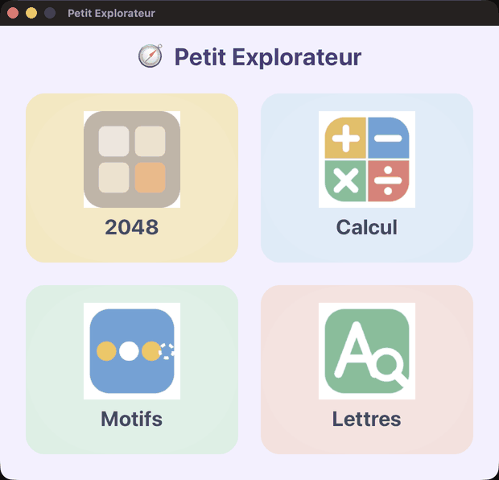

# PetitExplorateur

**A kid-friendly launcher for little learning games.** Big colourful tiles — tap one to play.
Built on [Hero](https://github.com/mesopelagique/Hero) (`cs.hero`): loads each game as a
component and launches it from a card, the way [PlayGallery](https://github.com/mesopelagique/PlayGallery)
does, but sized and simplified for a young child.

## Run it

Open the project — `On Startup` shows the menu. Tap a tile: it presses down and springs back,
then the game opens in its own window; close it to return to the menu.

## In the menu

| Tile | Game |
|---|---|
| **2048** | [2048](https://github.com/mesopelagique/2048) — slide and merge the numbers |
| **Calcul** | [MathQuiz](https://github.com/mesopelagique/MathQuiz) — true / false mental maths |
| **Motifs** | [PatternQuiz](https://github.com/mesopelagique/PatternQuiz) — what comes next in the pattern? |
| **Lettres** | [LetterDetective](https://github.com/mesopelagique/LetterDetective) — which picture starts with this letter? |

More games will join — each is its own base built on Hero.

## How it works

Each game publishes one shared entry point, `PLAY_<name>`; that's the whole contract. A tap
doesn't launch straight away — `cs.CardFx` presses the tile first (a translation down then a
spring back, all three parts moving as one), and the game is opened only from the end of that
animation, because the dialog is modal and would otherwise swallow the press.

**Adding a game:** give it a tile in the `Demo` form, add it to `dependencies.json`, and add a
branch to `LAUNCH_ENTRY` — the compiler then checks the new launcher exists.
